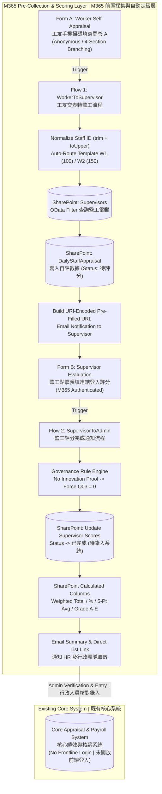

# EnterpriseDemo-DailyStaffAppraisal
**Zero-License Frontline Performance Appraisal Pre-Collection & Automated Scoring Workflow (Microsoft 365)**  
**零授權前線日薪員工績效評估前置採集與自動定級工作流（Microsoft 365 低代碼治理架構）**

[](https://github.com/jackylawck/EnterpriseDemo-DailyStaffAppraisal)
[](#)
[](docs/compliance-and-governance-assessment.md)
[](docs/compliance-and-governance-assessment.md)
[](#)
[](LICENSE)

> **🌐 Interactive Showcase & Live Scoring Simulator | 互動式架構展示與計分防呆模擬器：**  
> **[https://jackylawck.github.io/EnterpriseDemo-DailyStaffAppraisal/](https://jackylawck.github.io/EnterpriseDemo-DailyStaffAppraisal/)** *(Enable GitHub Pages on `main` / `/ (root)` to view live | 於 Settings $\rightarrow$ Pages 啟用後即可線上互動測試)*

---

## 1. Executive Summary & Architectural Positioning | 專案摘要與架構定位

### Why This Pre-Collection Intake Layer Exists | 為什麼需要這套前置採集層？
* **English:**  
  The enterprise already operates a mature **Existing Core Appraisal System** for final HR archiving and payroll reconciliation. However, due to licensing boundaries and security isolation, frontline daily-paid / site workers are not provisioned with corporate Microsoft 365 accounts and cannot log into the core system directly. Previously, collecting self-appraisals and supervisor ratings relied heavily on paper forms and manual spreadsheet consolidation—creating administrative bottlenecks and leaving scoring rules vulnerable to human inconsistency.  
  **EnterpriseDemo-DailyStaffAppraisal** implements a **Zero-License Edge Intake (Sidecar) Pattern** using standard Microsoft 365 connectors (`Forms`, `Power Automate`, `SharePoint Online`, and `Outlook`). Without modifying the legacy core system or purchasing additional frontline user licenses, it automates mobile self-assessment intake, URI-encoded pre-filled supervisor routing, deterministic zero-score rule enforcement, and weighted grading—delivering clean, verified records ready for HR administrators to reconcile into the core system.

* **繁體中文：**  
  企業內部已建置運作穩定的**既有核心績效評估系統（Core Appraisal System）**，負責最終的人事歸檔與薪酬核算。然而，基於授權成本控制與資安邊界考量，前線日薪／工地員工並未配置企業級 M365 帳號，亦無法直接登入核心評估系統。過往的前期自評與主管評分高度依賴紙本傳遞與人手 Excel 統計，不僅耗時，更難以落實評核防呆。  
  **EnterpriseDemo-DailyStaffAppraisal** 採用 **「無授權邊緣採集前置層」（Zero-License Edge Intake / Sidecar Pattern）** 設計，在**完全不更動既有核心系統架構**、亦**不增加前線員工軟體授權成本**的前提下，利用 Microsoft 365 標準連接器（`Forms` + `Power Automate` + `SharePoint` + `Outlook`）搭建自動化前期數據採集與定級引擎，最終將標準化結果匯出予 HR 及行政團隊錄入核心系統。

---

## 2. Core Governance & Engineering Highlights | 核心治理與技術亮點

* **Zero-License Frontline Intake + Authenticated Supervisor Review | 零額外授權與雙軌身份驗證**
  * **Form A (Worker Self-Appraisal / 問卷 A 工友自評)**：Configured as `Anyone can respond` (`任何人都可以回應`), enabling non-licensed frontline staff to submit self-appraisals via mobile QR Code without login credentials, supported by 4-section conditional branching and write-only ingress isolation.
  * **Form B (Supervisor Evaluation / 問卷 B 監工評核)**：Restricted strictly to `Only people in my organization can respond` (`只有我組織中的人員可以回應`), enforcing corporate M365 authentication and non-repudiable audit logging.

* **Pre-Filled URL Relay with URI Encoding | 預填網址接力架構**
  * Flow 1 normalizes the worker's Staff ID (`trim` + `toUpper`), queries the supervisor's corporate email from SharePoint via OData filtering, and dynamically constructs a parameterized Form B URL using `encodeUriComponent()`, eliminating manual transcription errors across desktop and mobile mail clients.

* **Dynamic Dual-Track Template Routing (`W1` vs. `W2`) | 雙軌動態模板路由**
  * Automatically classifies the appraisal template based on job role: **Supervisory roles (`工頭` Foreman / `助理工頭` Assistant Foreman)** route to **Template `W2` (15 criteria, 150 max weighted points)**, while **general trades (`一般工種`)** route to **Template `W1` (10 criteria, 100 max weighted points)**.

* **Deterministic Governance-as-Code | 確定性規則引擎與防呆設計**
  * **Substantiation-Enforced Zero-Score Rule (實證強制零分規則)**：For Criterion 3 (*"Creativity & Innovation / 創造力及創新思維"*), if a supervisor leaves the justification blank or enters non-substantive placeholders (`無`, `沒有`, `冇`, `N/A`, `-`, `0`, etc.), Power Automate deterministically overrides the Q03 score to `0`—preventing unsubstantiated or inflated ratings.
  * **Null-Safe Branch Casting (分支空值安全轉型)**：Criteria Q11–Q15 skipped by `W1` workers are safely cast via `if(empty(...), 0, int(...))` prior to SharePoint numeric ingestion, preventing runtime type-mismatch failures.

---

## 3. End-to-End Architecture & Lifecycle | 端到端系統流程圖與生命週期



| Stage / 階段 | Responsible Role / 責任角色 | Platform / 承載平台 | Governance Action & Audit Control / 處置動作與內控機制 |
| :--- | :--- | :--- | :--- |
| **1. Self-Appraisal**<br>一、前線自評 | Daily-Paid Worker<br>日薪工友 | Microsoft Forms (`Form A`) | Scans QR code without login; completes 4-section branched form; write-only ingress with zero backend read access. |
| **2. Dynamic Routing**<br>二、路由分流 | Automated Engine<br>自動化流程一 | Power Automate (`Flow 1`) | Normalizes Staff ID, assigns `W1`/`W2` template, writes staging record, and sends URI-encoded pre-filled link to supervisor. |
| **3. Supervisor Review**<br>三、主管評核 | Site Supervisor<br>地盤監工 | Microsoft Forms (`Form B`) | Authenticates via corporate M365 account; verifies pre-filled worker details; submits ratings and Q03 innovation proof. |
| **4. Rule & Grading**<br>四、防呆定級 | Automated Engine<br>流程二與清單 | Power Automate (`Flow 2`) + SharePoint | Enforces Q03 zero-score rule if unsubstantiated; calculates weighted total, percentage, 5-point average, and Grade `A–E`. |
| **5. Core Archiving**<br>五、核心歸檔 | HR Admin Team<br>HR 行政團隊 | Outlook + Core HR System | Receives completion alert, verifies scores in restricted SharePoint list, reconciles into Core System, and purges staging data. |

---

## 4. Regulatory Compliance & Non-AI Governance Scope | 法規合規與確定性非 AI 治理邊界

* **Deterministic Non-AI Scope-Out (確定性非 AI 系統定性)：**  
  This workflow operates strictly on transparent, deterministic arithmetic and conditional logic with mandatory human-in-the-loop evaluation by authenticated supervisors. **No Machine Learning (ML), Generative AI (GenAI), or automated profiling models are deployed**, intentionally remaining outside the regulatory scope of High-Risk AI frameworks (e.g., **EU AI Act Annex III**, **ISO/IEC 42001**, and **PRC CAC Algorithm/GenAI Measures**).
* **Privacy & Information Security Alignment (私隱與資訊安全對齊)：**  
  Controls are rigorously aligned with **Hong Kong's Personal Data (Privacy) Ordinance (PDPO, Cap. 486)**, **ISO/IEC 27001**, and **ISO/IEC 27701**, incorporating bilingual **Personal Information Collection Statements (PICS)** at ingress, role-based access isolation, and UTC audit timestamps. See [`docs/compliance-and-governance-assessment.md`](docs/compliance-and-governance-assessment.md) for the complete statutory mapping.

---

## 5. Repository Structure | 專案目錄結構

```text
EnterpriseDemo-DailyStaffAppraisal/
├── index.html                                     # Interactive bilingual showcase & score simulator | 中英文互動架構與計分模擬器
├── README.md                                      # Bilingual overview & architecture | 中英文專案總覽與架構圖
├── SECURITY.md                                    # Security & sanitization policy | 資訊安全與脫敏合規政策
├── LICENSE                                        # MIT License
├── docs/
│   ├── forms-design-and-branching.md              # Forms 4-section branching & 15-item weights | 問卷分支邏輯與權重矩陣
│   ├── sharepoint-schema-and-formulas.md          # SharePoint schema & 4 calculated formulas | 資料庫結構與自動計分公式
│   ├── power-automate-expressions.md              # Sanitized Power Automate fx expressions | 核心運算式與防呆邏輯庫
│   ├── compliance-and-governance-assessment.md    # PDPO, ISO 27001/27701 & AI Scope-Out Assessment | 法規合規、資安私隱及 AI 治理評估
│   └── deployment-and-uat-checklist.md            # Deployment guide & UAT verification matrix | 部署指引與端到端驗收清單
├── flows/
│   ├── Flow1_WorkerToSupervisor.json              # Sanitized Flow 1 definition (Worker -> Supervisor) | 脫敏版流程一 JSON 定義
│   └── Flow2_SupervisorToAdmin.json               # Sanitized Flow 2 definition (Supervisor -> Admin) | 脫敏版流程二 JSON 定義
└── schemas/
    └── daily_staff_appraisal_schema.json          # JSON Schema data contract & validation rules | 數據結構與校驗規則 Schema
```

---

## 6. Deployment & UAT Quick Reference | 部署與驗收測試指引

1. **Provision SharePoint Lists**：Create `Supervisors` and `DailyStaffAppraisal` using the schema and 4 calculated column formulas in [`docs/sharepoint-schema-and-formulas.md`](docs/sharepoint-schema-and-formulas.md).
2. **Configure Forms & PICS**：Build `Form A` (`Anyone can respond`) and `Form B` (`Only people in my organization can respond`) with the 4-section branching rules and bilingual PICS header in [`docs/forms-design-and-branching.md`](docs/forms-design-and-branching.md).
3. **Import & Bind Flows**：Configure `Flow 1` and `Flow 2` using the sanitized definitions in [`flows/`](flows/) and expressions in [`docs/power-automate-expressions.md`](docs/power-automate-expressions.md).
4. **Execute UAT Matrix**：Verify `W1`/`W2` routing, `Q03` zero-score enforcement, Staff ID normalization, and access isolation via [`docs/deployment-and-uat-checklist.md`](docs/deployment-and-uat-checklist.md).

---

## 7. Disclaimer & License | 免責聲明與授權

* **Sanitization Disclaimer (脫敏合規聲明)：** This repository is a generic enterprise architecture demonstration created for research and Proof-of-Work purposes. All corporate names, domains, SharePoint URLs, Microsoft Forms GUIDs, and personnel records have been removed and replaced with generic placeholders.
* **License (開源授權)：** Released under the [MIT License](LICENSE).
