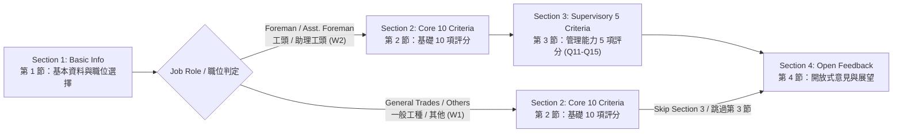

# Microsoft Forms Architecture, Branching Logic & Weighting Matrix
# Microsoft Forms 問卷架構、4 節分支跳轉邏輯與評分權重矩陣

This document details the front-end intake design for **Form A (Worker Self-Appraisal)** and **Form B (Supervisor Evaluation)**, including conditional branching rules, pre-filled URL parameter mapping, and the 15-criterion weighting matrix.  
本文件詳細說明前端數據採集介面——**問卷 A（工友自評表）**與**問卷 B（監工專用評分表）**的版面分節結構、條件分支跳轉邏輯、預填網址參數對應，以及 15 項績效指標權重矩陣。

---

## 1. Dual-Form Access & Security Isolation | 雙問卷權限與存取隔離設計

| Attribute / 屬性 | Form A: Worker Self-Appraisal<br>問卷 A：工友自我評估表 | Form B: Supervisor Evaluation<br>問卷 B：監工專用評分表 |
| :--- | :--- | :--- |
| **Target Users / 適用對象** | Frontline daily-paid workers (No M365 license)<br>前線日薪工友（無企業 M365 帳號） | Site supervisors & foremen (Licensed M365 users)<br>地盤監工及管理人員（具公司 M365 帳號） |
| **Access Setting / 權限設定** | `Anyone can respond` (Anonymous QR Code)<br>任何人都可以回應（掃碼免登入） | `Only people in my organization can respond`<br>只有我組織中的人員可以回應（強制登入驗證） |
| **Entry Method / 進入方式** | Direct QR Code poster at construction sites<br>掃描地盤現場海報 QR Code 直接進入 | Personalized pre-filled URL emailed by Flow 1<br>點擊 Flow 1 發送之專屬預填連結進入 |
| **Identity Capture / 身份紀錄** | Manual Staff ID + Name (Normalized by Flow 1)<br>手動輸入編號與姓名（由 Flow 1 自動正規化） | Automatic M365 user principal capture + Pre-filled ID<br>系統自動記錄登入者帳號，並核對預填員工編號 |

---

## 2. Form A: 4-Section Conditional Branching Design | 問卷 A：4 節分支跳轉邏輯

To prevent general workers (`W1`) from seeing irrelevant supervisory questions while ensuring foremen (`W2`) complete all 15 items, Form A is structured into 4 sections:  
為確保一般工種（`W1`）無需面對管理層題目，同時讓工頭及助理工頭（`W2`）完整填寫 15 項指標，問卷 A 採用 4 節動態分流設計：



* **Section 1 (Basic Information / 第 1 節：基本資料)**：Staff ID (`員工編號`), Full Name (`員工姓名`), Job Title (`職位`), Designated Supervisor (`所屬監工` — Dropdown matching SharePoint `Supervisors` list).
* **Section 2 (Core Competencies Q01–Q10 / 第 2 節：核心能力指標 1–10 題)**：Required for all workers (`W1` & `W2`). Includes mandatory substantiation text box for **Q03 (Creativity & Innovation)**.
* **Section 3 (Supervisory Competencies Q11–Q15 / 第 3 節：管理能力指標 11–15 題)**：Displayed **only** to `工頭` (Foreman) and `助理工頭` (Assistant Foreman).
* **Section 4 (Career & Feedback / 第 4 節：意見與工作展望)**：3 open-ended text questions (`進步提升`, `工作改進`, `前景展望`), ending with form submission.

---

## 3. Form B: Pre-Filled URL Parameter Mapping | 問卷 B：預填網址參數對照

Flow 1 generates a pre-filled link using Microsoft Forms' native query parameters (`&<QuestionGUID>=<EncodedValue>`), locking in worker context before the supervisor starts rating:

Flow 1 透過 Microsoft Forms 原生查詢參數動態組裝預填網址，讓監工開啟表單時自動帶出工友資料：

| Pre-Filled Field / 預填欄位 | Placeholder Token in Flow 1 | Encoding Function / 編碼方式 |
| --- | --- | --- |
| **員工編號 (Staff ID)** | `STAFFID_HERE` | `encodeUriComponent(outputs('Clean_StaffID'))` |
| **員工姓名 (Worker Name)** | `NAME_HERE` | `encodeUriComponent(outputs('Create_item')?['body/StaffName'])` |
| **職位 (Job Title)** | `JOB_HERE` | `encodeUriComponent(outputs('Create_item')?['body/JobTitle'])` |

---

## 4. 15-Criterion Assessment & Weighting Matrix (`W1` vs. `W2`) | 15 項能力指標與比重對照表

Each criterion is rated on a **1 to 5 scale** (`1 = Poor / 惡劣`, `5 = Excellent / 優異`) and multiplied by its designated weight in SharePoint:

每項指標均採 **1 至 5 分制**評核，並於 SharePoint 依據下表權重自動加權計算：

| Item # | Assessment Criterion (評估指標) | Weight


(比重) | W1 Max


(一般工種) | W2 Max


| (工頭/助理工頭) | Governance Rule (治理防呆規則) |
| --- | --- |
| **Q01** | 團隊精神、服從性及工作態度 |


(Teamwork, Compliance & Attitude) | $\times 2$ | 10 | 10 | Standard 1–5 rating |
| **Q02** | 責任感、自律及積極性


(Responsibility, Self-Discipline & Initiative) | $\times 2$ | 10 | 10 | Standard 1–5 rating |
| **Q03** | **創造力及創新思維**


**(Creativity & Innovative Thinking)** | $\times 1$ | 5 | 5 | **Forced `0` if justification is blank or `無/N/A**`


**無具體實證自動計 `0` 分** |
| **Q04** | 自我增值及提升個人能力


(Self-Enhancement & Capability Growth) | $\times 1$ | 5 | 5 | Standard 1–5 rating |
| **Q05** | 按時完成所分配工作


(Timely Completion of Assigned Tasks) | $\times 3$ | 15 | 15 | High-weight core delivery metric |
| **Q06** | 技術質量及手工藝


(Technical Quality & Workmanship) | $\times 3$ | 15 | 15 | High-weight quality metric |
| **Q07** | 解決問題能力


(Problem-Solving Capability) | $\times 2$ | 10 | 10 | Standard 1–5 rating |
| **Q08** | 相關工作崗位之知識


(Job-Related Technical Knowledge) | $\times 2$ | 10 | 10 | Standard 1–5 rating |
| **Q09** | 安全及環保意識


(Safety & Environmental Awareness) | $\times 2$ | 10 | 10 | Site safety compliance metric |
| **Q10** | 對公司或其他人之正面影響


(Positive Influence on Company & Peers) | $\times 1$ | 5 | 5 | Standard 1–5 rating |
| **Q11** | 及時作出決定並執行


(Timely Decision-Making & Execution) | $\times 2$ | *N/A (0)* | 10 | Supervisory tier (`W2`) only |
| **Q12** | 成本控制的意識和能力


(Cost Control Awareness & Capability) | $\times 2$ | *N/A (0)* | 10 | Supervisory tier (`W2`) only |
| **Q13** | 安排及管理團隊的工作，例如派工


(Team Scheduling & Task Allocation) | $\times 3$ | *N/A (0)* | 15 | Supervisory tier (`W2`) only |
| **Q14** | 協助團隊的培訓發展及工藝傳承


(Team Coaching & Craftsmanship Transfer) | $\times 1$ | *N/A (0)* | 5 | Supervisory tier (`W2`) only |
| **Q15** | 鼓勵、指導及支持團隊完成目標


(Encouraging & Guiding Team to Goals) | $\times 2$ | *N/A (0)* | 10 | Supervisory tier (`W2`) only |
| — | **Total Weighted Score (加權總分滿分)** | — | **100** | **150** | Auto-calculated in SharePoint |

```

